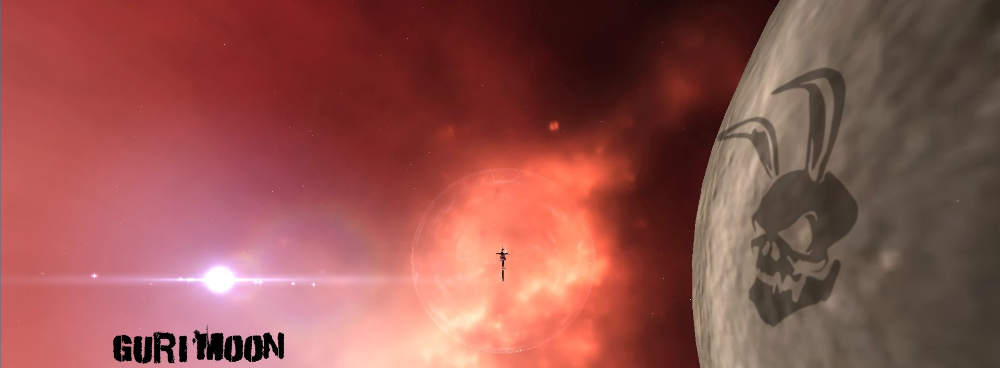

  

# GuriMoon

**An EVE Online server emulation project for client version 3913 - Red Moon Rising (2005) written in .Go**

Discord Server - https://discord.gg/nzYsvvazZ

GuriMoon is a server emulator compatible with EVE Online's 2005 Red Moon Rising 3913 ‘Blood' client. The dawn of the titan shipline, and the last build featuring some of CCP/FC's more interesting design choices for EVE. All encapsulated in EVE Online's original graphics engine before its first major graphics overhaul with Trinity (2008). This is NOT the client, and it is not in the repo.

Originally a part of the EveClassic project started by PixelCatBurglar, which was a broader initiative to create connectable emulators for multiple builds of EVE. (Yes, there's more.) GuriMoon is specifically focused on full restoration of EVE's 1931a version of Red Moon Rising. While also providing tools to give you the ability to modify and create your own experience to your preferences.

Of course, EVEClassic and GuriMoon owe their existence to the original EVEmu project and community. The original developers of EVE Online server emulation tech as far back as 2005. The community initially tried to get Red Moon Rising emulated, but moved on to work on, and succeeded in emulating Crucible (2013). GuriMoon/EVEClassic is a .go rewrite of their original work.

## Quick start

1. Install Go, MariaDB and Git, and have your own Red Moon Rising client ready.
2. Load the database from `sql/`, copy `config.example.json` to `config.json`, run `rebuild.bat`, start `gurimoon.exe`.
3. Type `127.0.0.1` in the client's Server box and log in.

The full walkthrough, with every command, is in [SETUP.md](SETUP.md). Docker is supported too.

## Documentation

| File | What it covers |
|---|---|
| [SETUP.md](SETUP.md) | Install, run, connect, admin panel, Docker, troubleshooting |
| [DEPENDENCIES.txt](DEPENDENCIES.txt) | Everything the server needs and nothing else |
| [docs/config-settings.md](docs/config-settings.md) | `config.json` and the live server settings |
| [docs/slash-commands.txt](docs/slash-commands.txt) | In-game GM slash commands |
| [docs/DUNGEON_EDITOR_GUIDE.txt](docs/DUNGEON_EDITOR_GUIDE.txt) | Building dungeons and missions with the ESP editor |

## AI Disclaimer

I do not come from any software development background. AI was heavily used in the creation of this server emulator.

This project was a hobby. I used AI to create and code it up to a playable state. Now this isn't to say there wasn't any attempt on my part to actually try and understand the game I was working with and what does what and why. This wasn't a one-shot prompt and done. It was built bit by bit, wrangling errors and misconceptions as they emerged. Totalling in what I believe is an authentic and reliable experience.

To be frank, I'm sick of AI. I wanna be done with it. I don't like the culture built up around it, what it does to people. I don't really see myself trying to use AI in any other serious capacity past this emulator project.

Because I used AI, I wrote out this readme to articulate the project in my own words to get across I do possess some understanding of my own project here.

## Ethics, Etiquette and Safety

By making this repo public, I realize I forfeit my ability to keep it controlled. So I ask for some etiquette to consider if you decide to give this emulator a try.

Using GuriMoon to fabricate misinformation about players or groups, or trying to pass off screenshots as authentic from the time period - Are all bad faith usage of this program. You do what you want with the server, but it stays on that server. On your machine.

That's not to say you can't show off all the cool stuff on display. Please do, just clarify what is being shown is from an emulator, and not a real screenshot from back in the day. Do not create a shareable “Private Server” for your friends or wider public. If you excite someone while sharing your gameplay, tell them to set up GuriMoon and host their own environment on their machine.

I'd go into a spiel about legality and whatever - But the real concern is safety for you and others. GuriMoon was not designed to be a multiplayer hosted server. It was designed with one user in mind. So long as you stay on your own computer and keep it that way, you'll be fine. Take it past your local address? That's at your risk and anyone you rope into connecting.

Don't do it. You've been warned.

Which brings me to my last point. Please support Fenris Creations and the official retail version of EVE Online, EVE Frontier, and EVE Vanguard.

## Functional Mechanics

**Space Travel**
* Obvious one, but worth mentioning. Space flight is fleshed out and polished, separated grid ‘bubbles’ per celestial.

**Character Progression**
* Train skills, earn money, gain standings, accumulate assets. Skill training continues even with the server offline, simple time reduction between last time it was online. A creative liberty was taken and a skill queue was backported to serve both as a GM tool (See ESP tool section) and in-game service usable through the “Galnet” Browser (See Ingame-Browser below)

**Combat**
* Combat is fully functional, shoot NPCs in belts or missions/Dungeons. Get loot. EWAR is functional, and ‘Dogma’  enforces modifiers like skills and implants accordingly. Shoot other player characters.

**Industry**
* Classic industry mechanics. Stations have a finite amount of lines for you to conduct manufacturing or research jobs. Research is a never ending time sink. The ‘T2 BPO lottery’ system R&D agents ran among themselves has been restored to the best it can be based on old screenshots and anecdotal testimonies.

**Agents**
* Agents are functional and can issue missions and provide other services like character locator and the aforementioned T2 BPO lottery. Caveat - we don't have any of the original mission data, but tools have been provided (See ESP tool section) for you to create your own mission content and easily place it into rotation. A few level 1 missions created by me have been shipped with this repo for proof of concept.

**Dungeons**
* Dungeons are the locations of EVE that are all your  RP flavor landmarks and combat encounters in missions or exploration site. These are database read template layouts the game world spawns in. Like with original mission data, we don't have dungeon data. Instead we have the tools (See ESP tool section) to make your own, and this repo will be shipped with a few dungeons for example (both for missions and ‘open’ PvE combat encounters)

**Markets & Economy**
* Standard market UI is functional, taking and handling buy and sell orders. On top of that, Courier & Escrow services (Precursor to ‘Contracts’) are functional. Standard buy and sell orders from NPC corps exist to engage with, along with tools to modify these offerings.

**Player-owned-Starbases (PoS)**
* PoS structures are implemented and functional. And this includes moon mining - which we don't have proper data of the era on - but have the tools to scramble your own data for your server (See ESP tool section)

**In-Game Browser/Billboards**
**[ADDITIONAL SETUP REQUIRED]**
* The in-game browser does not function in its original form of being an in-game portal to browse the opennet. Instead it has been repurposed to direct internally to become the “Galnet” Browser which offers some basic services like a Scope news page where you can post stories and even see them appear on in-game billboards or the character selection screen. Access your  character's skill queue via a service provided by Genolution, and even a BDED ran killboard to see kills and deaths of players. Getting this to function requires the setup of modifying a system file on your machine to add an endpoint locally for the client to pickup on. See [SETUP.md](SETUP.md) for instructions

## ESP Tool

ESP = ‘EVE Server Pages’

Packaged with the server is the ESP web page that you can access directly in your internet browser as long as the server is running. In this website are a wide spread of pages that talk to various tables throughout the database allowing you to modify, add and delete entries with a more human friendly front-end. No actual internet connection needed. 

To access ESP, type http://localhost:26080 into your browser while server is live. You will need an account with GM rights to access

**Admin**
* Tools related to general server functions

**Agents**
* Everything related to Agents, primarily where you would go to create and manage new mission data. As well as overview of the T2 BPO lotteries ongoing with agents. You can also create new agents as well.

**Characters**
* Category covers characters in the database, as well as alliances and corporations.

**Dungeons**
* Here you'll find the 3d editor tool to create your own dungeons (Needed for combat missions). Dungeons are made up of multiple database tables the game server reads off of to spawn into the world. Along the editor is a page to modify logic of dungeons (RP local chat, Pop-Up messages, wave triggers, loot tables) and to add dungeons to spawn into the world as runnable sites.
* To test your dungeons in-game, log into an account with GM Role and hit Shift-Alt-D to open the Dungeon Editor in game. Use /deadspace to teleport to an empty patch of space, and spawn in your dungeons. Because these are spawned off a database read, you can make edits in ESP, and reset/Respawn your dungeon in-game to see the changes without needing to restart the server.

**Landscape**
* All pages related to the landscape of the game world, this includes your solar systems and what they contain, with the ability to add new celestials or stations. You also have tools to modify  existing stations, change models, and services. As well as going over sovereign control of regions/systems.

**Industry**
* Pages related to blueprints, asteroid belts, and moon resources. Also a page to get an overview of all current science and manufacturing jobs happening in the game world

**Market**
* Pages related to the market tables, courier and escrow. More importantly, it also allows to speak to, and modify tables related to an NPC corps Supply/Demand (tells the game what NPC corps sell or buy items out of all their stations) and factions contraband.

## Modules

* GuriMoon supports customization though a module system that allows you to add onto the base server experience with modifications. This freedom is not here in some naive hope of a mod scene forming, but rather necessity to allow the user to opt-in-or-out of features that didn't need to be with the main repo. Most notably, the flagship module Rolebots, which is a service that allows you to populate your game world with playerbots that have persistent progression and much more. Along with several other additional modules that expand upon the Galnet browser feature. Consider these the ‘Official' modules of GuriMoon and their links. You can read more about them on their respective pages. If its not listed here, it is not a module directly endorsed by the GuriMoon project. Everything else is third party made customizations

- Rolebots - https://github.com/SODANK/GM-Rolebots

## Contributing

I've not managed my own GitHub project before and thus not fully prepared to start screening pull requests for GuriMoon. That's not to say I wouldn't consider any, but there will be some ground rules

* Edits that REQUIRE the client to be patched will be refused outright. GuriMoon strived to be operated with no mandatory client patching
* Creating tools or services that can connect to official FC API endpoints will be rejected outright. That means not creating a seeder that rips live retail EVE markets to apply to your server here in GuriMoon.

## Special thanks

**PixelCatBurglar**
* Starter of EVEClassic project which GuriMoon inherits its foundation from.

**EVEmu community**
* Original pre-LLM era developers who paved the way and pioneered EVE emulation technology.

**EVE-Files / 2005-2006 EVE Community**
* Eve-Files was an invaluable source of evidence and insight to the time period and helped me piece together and confirm critical mechanics. It was the players who thought to upload the most random screenshots that really made this emulator as good as it is. It's not a perfect 1:1, but EVE Players of 2006 sure helped me get close. There's too many of your people to name and frankly 80% of you aren't even paying attention anymore. Likely I've seen your screenshot if you posted something back then.

**Fenris Creations**
* EVE Online is an important MMO and this project isn't meant to be seen as a hostile act towards the company. Working on this I've developed a new appreciation for the developers who struggled with this game to get it to where it is today.
